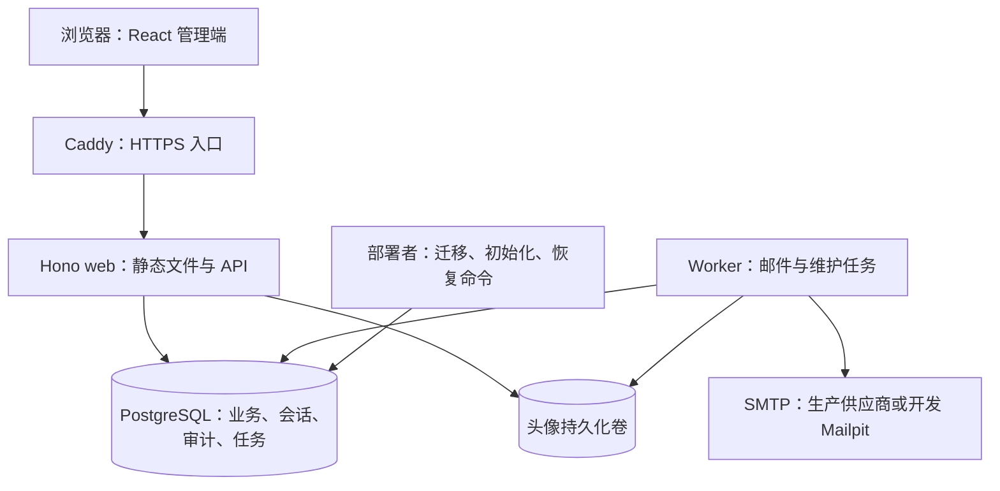
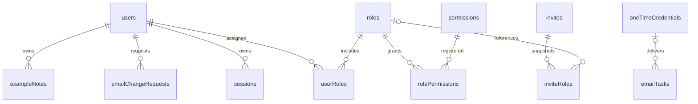
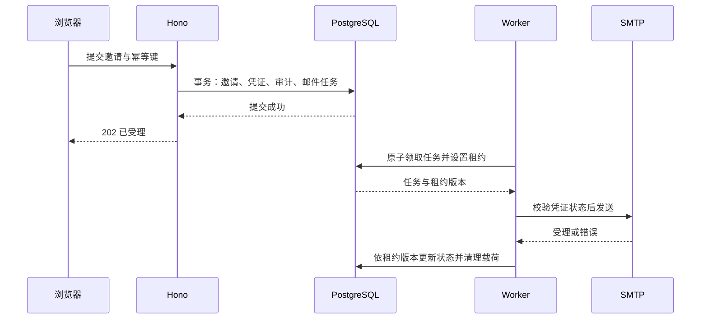

# HonoCraft 架构设计

| 项目 | 内容 |
| --- | --- |
| 版本 / 日期 | v0.1 / 2026-10-10 |
| 需求依据 | [PRD v1.2](2026-10-10-honocraft-prd.md) |
| 状态 | 架构建议稿，可用于评审；不是已实现或已验证的系统说明 |
| 已确认技术方向 | Hono + TypeScript、React、PostgreSQL、Docker 单机部署 |
| 本文产出 | 架构取舍、模块契约、数据设计、关键事务、安全机制、部署恢复及验收映射 |

## 1. 设计目标与边界

交付一个开发者可复制、修改、独立部署的单租户后台源码模板。P0 完成“启动 → 初始化 → 邀请 → 授权 → 撤权 → 审计”，并以可移除的个人笔记模块验证复用能力。

一个部署实例只有一个数据和管理域，不增加 Tenant、Organization、计费、在线插件或通用工作流。OAuth、MFA、批量邀请属于 P1；P0 只留下必要接口，不提前建设这些流程与页面。

架构必须满足以下不变量：

1. 撤权、禁用及会话撤销成功提交后，旧会话的下一次受保护请求失败。
2. 管理写入、授权版本更新、会话撤销、成功审计及相关邮件任务共同提交。
3. 用户邮箱全局唯一，软删除后仍占用；邀请和一次性凭证只能成功消费一次。
4. 并发管理操作不能消除最后一名可用超级管理员。
5. 功能权限不能替代资源归属检查，超级管理员也遵守业务模块定义的资源边界。
6. 恢复备份不能复活旧会话、旧邀请链接和旧重置链接。

除用户已确认的技术方向与 PRD 已确认的阶段外，本文的具体库、版本、目录与运维参数均为建议基线。采用 PRD 的其余建议规则作为设计输入，不将其改写成已获用户确认的产品决策。

## 2. 方案比较与技术决策

### 2.1 整体形态

| 方案 | 收益 | 成本 | 结论 |
| --- | --- | --- | --- |
| 模块化单体 + 同源 React SPA + 独立 worker 进程 | 授权与审计可共享事务，部署简单，业务模块边界清晰 | 需要维护明确的前后端契约 | 采用，与已确认技术方向一致 |
| 全栈 SSR 框架 | 页面和服务端路由集中，适合服务端渲染需求 | 本项目没有 SEO 需求；额外服务端渲染链路不改善核心授权一致性 | 当前不采用 |
| 微服务或 Edge 多服务部署 | 各服务可独立扩缩容 | 跨服务一致性、任务和文件存储复杂，增加本地开发与恢复成本 | 超出 P0 |

采用一个代码库、一个应用发布版本和一个数据库。`web` 与 `worker` 使用同一个镜像、不同启动入口；它们是同一应用的两个进程，不建立跨服务业务协议。生产 React 静态文件由 Hono 提供，浏览器与 API 同源。

### 2.2 建议技术栈与支持矩阵

| 层次 | 建议选择 | 选择理由 / 支持边界 |
| --- | --- | --- |
| 运行时 | Node.js 24 LTS、TypeScript strict | 只验证一条生产运行时；Node 官方当前列出 24 为 LTS [S1] |
| 包管理 | pnpm 10、workspace | 锁文件与 `packageManager` 固定实际版本；不增加任务编排平台 |
| HTTP | Hono 4 + `@hono/node-server` | Hono 官方提供 Node 适配与静态资源服务 [S2] |
| 管理端 | React 19 + Vite + React Router | 内部管理 SPA；按页面懒加载 |
| 前端状态 | TanStack Query；React Hook Form + Zod | 服务端状态、表单状态分离；普通 UI 状态留在组件中 |
| UI | Tailwind CSS + shadcn/ui；i18next | 源码可定制，统一表单/对话框模式，中文与英文文案 |
| API 契约 | Zod + `@hono/zod-openapi` | 请求与响应显式建模，生成 OpenAPI；数据库实体不作为响应 DTO |
| 数据 | PostgreSQL 17 + Drizzle ORM + `pg` | 强约束、显式事务与 SQL；Drizzle 提供事务 API [S3]；PG 17 仍受支持 [S4] |
| 密码与图片 | `argon2`、`sharp` | 密码和图片转换使用维护中的库；验证 Linux 镜像中的原生依赖 |
| 邮件 | Nodemailer SMTP；开发 Mailpit | 一种生产适配器即可完成 P0；捕获服务仅开发启用 |
| 日志与测试 | Pino、Vitest、Playwright | 结构化脱敏日志、真实 PG 集成测试、浏览器流程验收 |
| 交付 | Docker Compose + Caddy | 单机 HTTPS 入口；持久化 PG 与头像目录 |

M0.5 必须通过最小兼容性验证，再把以上依赖的实际版本锁入锁文件、镜像摘要和支持矩阵；本文不声称已经验证全部版本组合，也不使用浮动 `latest` 作为发布基线。

首版生产基线为 Linux x86_64、Docker Engine + Compose v2；开发基线为 Linux / WSL2。macOS、Windows 原生、ARM64、其他数据库与 Edge 不计入首版已验证支持范围。浏览器验收记录 Chrome、Edge、Firefox、Safari 的具体测试版本。工具安装和依赖下载需要网络；运行时对外依赖主要是 SMTP，不默认启用遥测。

### 2.3 认证组件的取舍

P0 采用应用拥有的认证状态机与数据库会话，使用成熟密码学库，不自行实现密码哈希或随机数算法。理由是 PRD 对邀请版本、邮箱修正、最后管理员、恢复失效、审计事务有具体要求，必须控制这些流程的事务边界。

可选方案是集成通用认证库，优点是减少常规认证代码，代价是逐项验证钩子能否覆盖上述原子操作。本文不假定任一认证库已经满足这些要求。认证维护成本属于本方案的明确责任：M1 必须完成安全集成测试与代码审查，不能把“使用 Argon2”当作认证系统已安全的证据。

预留 `PasswordHasher`、`SessionService`、`CredentialService` 接口；P1 再接入成熟 OAuth / TOTP 实现。业务模块只依赖当前身份和授权服务，不依赖认证库内部表。

## 3. 部署与依赖结构



| 组件 | 责任 | 故障行为 |
| --- | --- | --- |
| Caddy | TLS、请求大小上限、可信代理边界 | 失败时入口不可用；不公开 PG、SMTP 管理端口 |
| web | 页面、认证、授权、应用服务和查询 | PG 不可用时拒绝受保护访问，不退化为离线鉴权 |
| worker | 邮件领取/重试、到期清理、孤立文件回收 | 停止时任务仍在数据库，告警积压；API 可继续受理 |
| PostgreSQL | 业务与安全事实唯一来源 | 数据库事务决定业务是否完成 |
| 头像卷 | 已验证且重新编码后的媒体文件 | 上传失败不覆盖现有头像；已存在头像缺失时显示默认头像 |
| SMTP | 接受外发邮件 | 超时重试；不回滚已提交用户、邀请和重置请求 |

P0 不引入 Redis、独立消息队列、对象存储或搜索服务。限流、幂等与邮件租约均放在 PG，确保多进程不会各算一套状态。未来增加 Redis 时只能作为加速层，不能替代撤权事实。

## 4. 代码组织与模块契约

### 4.1 建议目录

```text
apps/
  server/src/
    entrypoints/             # web、worker、ops
    http/                    # 请求管线、错误处理、路由注册
    modules/
      auth/                  # 登录、密码、凭证、近期验证
      users/                 # 资料、状态、邮箱变更
      access/                # 角色、目录、委派与目标范围
      invitations/           # 邀请状态机
      audit/                 # 审计与安全事件
      mail/                  # outbox、模板、发送结果
      settings/              # 类型化业务配置
      files/                 # 头像存储与生命周期
      example-notes/         # 可移除的参考业务
    infrastructure/          # PG、密码哈希、SMTP、文件、时钟
  web/src/
    app/                     # 路由、布局、全局错误与登录状态
    features/                # auth、users、roles、invites 等页面
    components/              # 表单、表格、确认框、分页
    locales/                 # zh-CN、en
packages/
  contracts/                 # DTO schema、权限 Code、错误 Code
db/
  schema/                    # 各模块数据库定义
  migrations/                # 不可改写的版本化 SQL
scripts/                     # 配置、部署、备份与恢复入口
deploy/                      # 镜像、Compose、Caddy 配置
tests/                       # 集成、并发、E2E、迁移夹具
docs/                        # 快速开始、接入、运维、验收证据
```

这是目标结构，当前工作区尚无上述应用目录。单模块以 `routes / schemas / service / repository / policy` 按需要组织，不为简单查询强制创建多层抽象。

### 4.2 依赖方向

`HTTP 路由 → 应用服务 → 策略与 Repository → 基础设施`。

路由只解析输入、身份和响应；应用服务拥有事务；策略函数决定允许与否；Repository 必须接收该事务对象，禁止在事务中偷偷使用另一个全局连接。跨模块变更通过应用服务组合，业务模块不直接修改认证表。

| 模块 | 对外契约 | 依赖及边界 |
| --- | --- | --- |
| auth | `authenticate`、`requireRecentAuth`、`revokeSessions`、凭证签发/消费 | users、access 的只读身份视图；不在 Cookie 中保存权限事实 |
| users | 资料、状态、邮箱变更用例 | access 校验目标范围；auth 撤销；audit/mail 同事务 |
| access | `can`、`assertManageableTarget`、`assertGrantableRoles`、`authorizeMutation` | 权限目录、角色、用户；所有管理入口共用规则 |
| invitations | 创建、重发、撤销、接受 | access 资格复核、auth 凭证、mail、audit |
| audit | 事务内成功事件、独立失败事件、查询 | 接收允许字段摘要，不接受任意实体序列化 |
| mail | `enqueue(tx, event)`、worker 领取与结果 | SMTP 接口、加密接口；不直接创建用户或授予权限 |
| settings | 类型化读取、整组校验与更新 | 安全项走 access；密钥来自部署环境 |
| files | 临时上传、验证、发布、回收 | 文件卷和文件元数据；不支持外链抓取 |
| example-notes | 本人笔记 CRUD | 当前身份、授权事务、审计；不读取密码/凭证表 |

模块注册声明包含路由、权限目录、导航和启用条件。声明公开、本人、权限三类访问策略；路由工厂缺少策略时构建失败，并通过路由清单测试发现直接挂载、绕过工厂的接口。

## 5. 数据设计

### 5.1 通用约定

- 业务主键使用应用生成的随机 UUID；外键均使用稳定 ID，不使用邮箱。
- 时间使用 `timestamptz`、数据库时间为安全判定基准、UTC 存储；IP 使用 `inet`。
- 状态使用文本 + CHECK 约束；JSONB 仅用于偏好、允许字段审计摘要和有 schema 的配置，不存核心关联。
- 可编辑聚合有递增 `version`；`authorization_version` 单独用于访问撤销，不混用。
- 用户的 `status` 与 `deleted_at` 约束一致；Deleted 邮箱仍参与完整唯一索引。
- 业务外键默认 RESTRICT。软删除不删除历史业务，审计保存目标 ID 和脱敏快照，不强制依赖会话或被审计对象的外键。

### 5.2 表与关键约束

| 表 | 核心字段（沿用 PRD，列出关键补充） | 约束与索引 |
| --- | --- | --- |
| users | 邮箱展示值/规范值、密码哈希、状态、验证时间、授权版本、版本、锁定时间、creation_source、registration_role_id | `normalized_email` 全表唯一；`(created_at DESC,id DESC)`；状态索引；creation_source 区分 registration/invitation/bootstrap |
| roles | code、内建/委派/注册资格、version | code 全表唯一且不可修改；保留内建角色 |
| permissions | code、module、保留/委派/自助属性、依赖 | code 唯一；仅迁移账户同步目录 |
| user_roles | user_id、role_id、assigned_by/at | 联合主键；反向 `(role_id,user_id)` 索引 |
| role_permissions | role_id、permission_id | 联合主键；permission_id 反向索引 |
| sessions | token_hash、user_id、授权版本、epoch、创建/活跃/近期验证/截止/撤销时间 | token_hash 唯一；有效会话按 user_id 查询的部分索引 |
| one_time_credentials | token_hash、purpose、用户/邀请/变更请求关联、subject_version、epoch、截止/消费/撤销时间 | token_hash 唯一；用途与关联一致；凭证绝不存明文 |
| invites | 邮箱、邀请人、状态、expires_at、version、接受者 | `status='pending'` 的 normalized_email 部分唯一索引 |
| invite_roles | invite_id、role_id、role_version_at_issue | 联合主键；role_id 反向索引；历史角色引用见下文 |
| email_change_requests | user_id、requested_by、新邮箱、状态、version、expires_at | 每 user 的 Pending 部分唯一索引；新邮箱不设占位唯一 |
| audit_events | actor、action、target、result、reason_code、changes、request_id、created_at | 时间/ID；操作者/时间；目标类型/ID/时间；action/时间 |
| security_events | user_id 可空、event_type、result、target_digest、request_id、时间 | 用户/时间、事件类型/时间；匿名目标用带密钥摘要 |
| email_tasks | event_key、用途、收件人、加密载荷、凭证引用、状态、尝试/租约/错误 | event_key 唯一；Queued 的 next_attempt_at/ID 索引；Sending 的租约到期索引 |
| system_settings | key、typed_value、version、updated_by/at | key 主键；整组配置事务校验 |
| system_state | 单行 ID、初始化状态、bootstrap_version、完成时间 | 单行约束；同时作为安全状态变更的协调锁 |
| idempotency_records | actor_id、operation、key_digest、request_digest、结果摘要、expires_at | actor/operation/key 联合唯一；不保存敏感完整响应 |
| rate_limit_buckets | scope、key_digest、window_start、count、expires_at | scope/key/window 唯一；原子计数，多进程共用 |
| file_objects | 随机 key、owner_id、用途、状态、大小、created_at | key 唯一；staged 清理索引 |
| example_notes | id、owner_id、title、body、version、created_at | `(owner_id,created_at DESC,id DESC)`；删除用户不级联删除笔记 |

公开注册的原始默认角色记录为 `users.registration_role_id`，Pending 激活时验证这一角色，而不是读取当时的新默认角色。P0 Pending 不开放额外角色分配；激活后才走普通角色管理。配置改变不回填已有账号。

角色删除同时检查 user_roles、Pending 用户原始注册角色、当前默认角色设置、Pending 邀请引用。历史 Accepted/Revoked/Expired 邀请保留角色 code/name/version 快照，显式清理其 live role_id 引用后才允许删除角色；不能让历史外键永久阻止删除，也不能静默撤销 Pending 邀请。

有效邀请唯一性不能使用包含 `now()` 的部分索引。数据库对所有 Pending 行约束唯一，创建/重发时在事务内把同邮箱已过期行转为 Expired；读取也按 expires_at 判断有效性，不能等待清理任务才能识别过期。邮箱变更请求采用同样原则。

列表使用允许字段排序、默认 20 / 最大 100、稳定 ID 次排序及总数。P0 支持页码分页；同次列表与 count 使用只读一致快照。不同翻页请求期间数据可能变化，不承诺跨请求快照。用户模糊搜索长度限制为 2–100 字符，规范邮箱与姓名使用 `pg_trgm` GIN 索引；审计不支持任意 JSON 全文扫描，靠明确过滤索引与执行计划验收。

### 5.3 关联概览



图只展示核心关联，审计与匿名凭证不强制附着用户；完整生命周期约束以上表和下文事务为准。

## 6. 认证、会话与浏览器安全

### 6.1 密码与登录

密码使用 Argon2id。初始候选为 memoryCost=65536 KiB、timeCost=3、parallelism=1，随机盐至少 16 字节，哈希以包含参数的标准编码保存；最终工作因子通过 2 vCPU / 4 GB 环境的并发测试确定，不低于 OWASP 推荐的 Argon2id 最低配置 [S5]。参数升级在成功验证后重新哈希，不强制全员换密。

密码长度按 Unicode 码点计算，默认 15–128，不 trim、不截断，注册、重置、修改密码共用校验。离线弱密码阻断集随模板版本分发，记录来源、许可、摘要与更新时间；至少覆盖常见密码和已泄露密码样本，禁止声称覆盖所有泄露数据。无需向第三方发送用户密码。不存在用户也执行同成本 dummy hash 验证；高成本哈希前做来源限流，并限制同时运行的哈希任务，避免挤占全部内存。

登录先完成格式、限流及密码验证，再开启短事务、获取安全协调共享锁，重新检查密码哈希版本、用户状态、锁定、角色与系统初始化状态；不通过则不建会话。成功创建全新随机会话、更新登录时间、清除失败计数并写安全事件。密码校验不占着数据库事务等待。

账号失败计数按规范邮箱的 HMAC 摘要存储，对不存在邮箱也执行相同窗口逻辑。账号暂锁使用统一登录失败响应；只有来源 IP 配额超限返回公开 429，避免账号特定锁定提示造成枚举。Pending 且密码正确时返回验证引导，不建立正式业务会话。

### 6.2 数据库会话

会话令牌使用 CSPRNG 生成 32 字节随机值，Cookie 只保存随机值；服务器以 SHA-256 保存和查找高熵令牌的摘要。SHA-256 仅用于这些随机令牌，不用于密码。会话记录保存签发时的授权版本与凭证代次 `credential_epoch`。

生产 Cookie：`__Host-honocraft_session`、HttpOnly、Secure、SameSite=Lax、Path=/，不设置 Domain。本地 HTTP 使用单独的开发 Cookie 名与配置；生产校验拒绝该配置。P0 使用浏览器会话 Cookie，关闭浏览器不作为可靠撤销，服务端过期规则始终有效。

每次受保护请求从数据库校验：

1. session 未撤销、用户 Active 且邮箱已验证。
2. session 的授权版本等于 user 的当前授权版本。
3. session 的 epoch 等于部署环境的当前 epoch。
4. 空闲与绝对期限均未到，取记录期限与当前策略计算期限中较早值。

P0 每次有效访问原子更新 last_seen_at 与空闲截止时间；没有“60 秒内复用鉴权结果”的缓存。延长策略不延长已有会话的绝对截止；缩短策略立即按原创建/活跃时间重新计算。会话更新只更新仍有效的行，绝不清空 revoked_at。列表展示可以延迟刷新，但服务端判断不依赖页面状态。

普通读请求以查询时的数据库状态为准，撤权前已通过检查的在途读不承诺撤回响应；撤权提交后的新请求必定失败。所有受保护写操作使用第 8 节事务授权入口，明确提交与撤权的先后顺序。

### 6.3 一次性凭证

统一凭证用途为 email_verify、password_reset、invite_accept、email_change、bootstrap、operator_recovery。每个凭证绑定用途、对象、对象版本、签发邮箱、固定到期时间与 epoch；对象关联由数据库约束与服务校验共同保证。

凭证同样为 32 字节随机值、数据库仅保存哈希。签发新版本时在同一事务撤销旧版本、取消旧待发送任务、建立新任务。消费采用行锁及条件更新，并与账号变更、角色绑定、审计共同提交；影响行数不为 1 即失败。

邮件链接建议使用 `https://受信实例/accept-invite#token=...` 这类 fragment 传递凭证；SPA 取出后用 history.replaceState 清除地址，并仅存页面内存，通过 JSON POST 提交。服务端不从 Host 头推导实例 URL。页面不加载第三方脚本或分析服务，设置 `Referrer-Policy: no-referrer`、`Cache-Control: no-store`。需要预览时使用只读 POST preview 接口，返回最少信息、不消费凭证；GET 页面永远无副作用。

匿名凭证接口有用途和来源限流，日志不记录请求体及完整 URL。令牌丢失或页面刷新需重新打开邮件，不写入 localStorage。P0 不承诺防御能主动填写并提交表单的恶意邮件客户端，但扫描器 GET 不消费。

### 6.4 CSRF、CORS 与请求管线

管线顺序：request_id → 请求大小/超时 → 安全响应头 → 可信来源提取 → 来源限流 → Origin/CSRF → schema → 会话 → 路由策略 → 应用服务 → 白名单响应与错误映射。

- 生产同源，默认不开放 CORS；开发 Vite 把 `/api` 代理到 Hono，不维护两套浏览器跨域认证方案。
- 所有浏览器写请求（包括登录、退出、重置与上传）都校验 Origin 精确等于配置的 PUBLIC_ORIGIN；缺失或不匹配拒绝。P0 不支持独立 API 客户端，运维命令直接调用应用服务。
- 登录后另使用与 session 绑定的 CSRF 值，以独立 CSRF 密钥对 session ID 与 epoch 做 HMAC 派生，由同源 `/api/v1/me` 返回，写请求必须带 `X-CSRF-Token`，服务端重新派生并常量时间比较。页面刷新和多个标签页获取同一会话的相同值，不需要保存或返还会话令牌明文。近期验证成功不自动重放原写请求。
- 匿名 JSON 写请求只接受 application/json；上传仅接受本人认证、正确 CSRF 和 multipart。不能把 SameSite 或某个默认中间件当作全部 CSRF 防线，Hono CSRF 中间件的处理范围需结合自定义校验验证 [S6]。
- CSP 默认 self，禁止对象嵌入与被第三方 framing；前端纯文本渲染、禁用任意脚本/CSS 注入配置。API 鉴权错误、用户响应和凭证页面 no-store。
- 前端 returnTo 仅允许已知站内相对路径。可信代理 CIDR 显式配置，只信任经该代理覆盖的转发头。

## 7. 授权模型与防提权

### 7.1 决策顺序

每个接口声明以下一种策略：`public`、`self`、`permission(code)`。有有效身份不代表拥有后台权限；没有角色的 Active 用户仍可访问本人资料、安全设置和会话。

管理写操作的统一判定为：

`有效会话 AND 操作权限 AND 当前目标可管理 AND 变更后的权限可授予 AND 必要近期验证 AND 版本匹配`。

对所有非超级管理员，目标当前持有的全部角色必须可委派，全部权限必须可委派且包含在操作者有效权限内，并且目标不拥有 admin / super_admin。即使请求只修正昵称、发送重置或更换邮箱，也不能省略目标范围判断。

授予、替换和移除角色都检查旧集合与新集合；超过范围整体拒绝。后台禁止修改自己的角色、禁用或删除自己。高权限账号操作还需 `user:manage-privileged` 与具体操作权限、当前会话 5 分钟近期验证和明确目标确认。

### 7.2 角色与目录

- `super_admin` 有效权限动态包含全部已注册权限，不能通过前端字段伪造；仍受最后管理员、本人保护、资源归属规则约束。
- admin / user 的基线来自版本化迁移，界面不能直接编辑内建权限。保留权限与委派/自助分配属性来自目录，后台只允许更改角色自身符合约束的资格。
- 非超级管理员不能编辑自己持有或分配给 admin / super_admin 的角色；编辑其他角色需检查其全部当前权限和拟新增权限。
- 角色编辑验证依赖闭包，禁止缺前置权限、保留权限注入和默认注册角色提权。复制生成新 code，不复制内建身份、委派与自助资格。
- 可委派与可注册自助分配相互独立。当前默认角色和 Pending 账号记录的角色必须持续满足自助条件；移除该资格需先处理配置/Pending 引用，不能暗中替换用户角色。
- 影响授权的角色内容变更递增角色 version；邀请绑定该 version。只改展示名称不改变授权，但仍递增编辑 version，P0 保守地要求旧邀请重发。

目录部署同步由迁移进程执行，不由每个 web 启动时自动执行。移除/重命名权限必须显式迁移引用并说明授权影响；目录属性或内建基线改变时同步撤销受影响会话。自定义角色不能因新增权限自动扩权。

### 7.3 资源范围

个人笔记使用 `WHERE id = :noteId AND owner_id = :actorId` 做读取与变更，越界统一 404；即使超级管理员具有 `example-note:read`，也不能绕过 owner 条件。列表同样按 owner 过滤，不能先取全量再在前端隐藏。

前端 `/me` 获取权限 Code 和可执行操作摘要用于展示，后端每次重新计算权限。缓存失效或按钮隐藏属于体验，不承担安全职责。

## 8. 事务、并发与幂等

### 8.1 安全协调锁

P0 选择容易证明正确的保守方案：以 `system_state` 单行作为安全协调锁。

| 操作 | 协调锁模式 | 原因 |
| --- | --- | --- |
| 登录签发会话、本人资料/普通业务写入 | FOR SHARE | 持锁后重新认证与鉴权，直到提交，防止并发撤权穿透 |
| 用户状态/邮箱/密码/角色、会话撤销、角色/权限、安全策略、邀请生命周期、初始化与恢复 | FOR UPDATE | 串行化安全状态变更与最后管理员检查 |
| 普通查询 | 不持全局协调锁 | 每请求读数据库；遵守第 6.2 节在途请求边界 |

事务必须在读取授权事实之前取得对应协调锁；禁止先用共享锁再升级。角色影响用户集合、邀请人资格、最后管理员计数均在取得锁后读取。持共享锁的业务写入会先于等待中的撤权提交；撤权先提交时，之后取得锁的业务写入看到失效身份并拒绝。这样提交前复核不会留下另一个撤权窗口。PG 行锁行为依据官方文档 [S7]。

锁顺序统一为：system_state → 按 ID 排序的 users → roles → sessions → invite / email-change / credential → idempotency → email-task → audit 插入。跨聚合服务不得反向调用。worker 领取只锁任务行、不回头获取 system_state；发送前使用只读检查，不造成反向锁等待。

默认 READ COMMITTED，依赖明确锁和约束；复杂多表授权在安全锁保护下读取。死锁/可重试事务错误最多重新执行 2 次，仅限无外部副作用且具备幂等保护的用例。事务中不执行 SMTP、图片转换或密码哈希。设置有限的锁等待与语句超时，超时返回可重试错误并记录原因，不长期占用连接。

代价是安全管理写操作串行；对 PRD 的单实例、1 万用户范围作为初始方案。普通读和多个普通业务写入可并发。若压测发现锁等待瓶颈，另行设计按账号/角色拆锁，并保留原有并发测试，不能只删除锁。

### 8.2 关键事务定义

| 用例 | 一次提交包含的内容 | 冲突与失败 |
| --- | --- | --- |
| 注册 | 复核注册开关/默认角色；Pending 用户与角色快照；验证凭证；邮件任务；事件 | 重复邮箱统一 202；不能因 SMTP 故障删除用户 |
| 激活 | 验证凭证与当前角色自助资格；标记邮箱已验证；Active；消费凭证；事件 | 用户已禁用、角色失效或凭证重放均不激活 |
| 接受邀请 | 校验邀请/版本/期限/epoch、邀请人当前资格和各角色版本；新用户与角色；消费凭证；Accepted；审计 | 邮箱竞争靠唯一约束；失败整体回滚，不创建半个用户 |
| 撤销/重发邀请 | 当前操作者授权与配额；旧凭证/任务失效；新版本/角色快照及新任务；审计 | 重发后记录当前操作者为新的 inviter，接受时检查该操作者资格 |
| 角色分配 | 目标范围与双方角色校验；user_roles；目标授权版本递增；撤销全部会话；审计 | 旧 version 返回 409；整体拒绝越界角色集合 |
| 修改角色权限 | 角色资格与依赖检查；角色版本；所有关联用户授权版本递增与会话撤销；审计 | 不异步逐批撤销，不在尚有旧权限时提前返回成功 |
| 禁用/删除 | 状态；授权版本；会话及未消费凭证撤销；取消相关邀请/任务；删除时清除角色；审计/通知 | 本人保护与最后管理员计数必须同事务 |
| 启用 | 按 email_verified_at 回 Active / Pending；审计 | 不恢复旧会话与凭证；Pending 需重新签发验证邮件 |
| 密码重置/修改 | 校验凭证或原密码版本；新哈希；消费/撤销所有重置凭证；撤销所有会话；事件/安全通知 | 不自动登录、不恢复禁用账号；旧哈希验证结果不能覆盖并发改密 |
| 邮箱变更完成 | 最新请求；目标/发起者当前资格；新邮箱唯一；更新邮箱；消费/撤销关联旧凭证与会话；取消旧凭证任务；通知与审计 | 唯一冲突返回 409；原地址保留；Pending 按原角色约束激活 |
| 安全配置 | 整组合法性、近期验证、默认角色约束；配置版本与审计 | 无效输入整体拒绝；短会话策略立刻被后续请求使用 |

最后管理员检查统计“Active、邮箱已验证、拥有 super_admin、具备有效本地密码”的账号；P0 临时登录限流不改变其业务身份。所有可能减少该集合的路径都使用排他协调锁，包括后续 P1 登录方式解绑/MFA 策略变化。管理员不能对自己执行后台降权、禁用、删除。

邮箱变更发起时就撤销 Pending 的旧注册验证凭证，并记录一项新的 Pending 请求；新邮箱不预占。取消或超时保留原邮箱及 Pending 状态，允许通过原流程重新签发原邮箱验证凭证。管理员发起的完成流程还检查发起者 Active 且仍具备操作权限与目标范围；不要求发起者当时仍在线。

### 8.3 幂等协议

邀请创建/重发、管理写入与安全写入接受 `Idempotency-Key`，建议 UUID，保存 24 小时。键作用域为 actor_id + operation + key；请求摘要覆盖目标 ID、期望 version、规范化正文，敏感字段采用带密钥摘要，原文不入库。

每次重试先验证当前会话、当前操作权限和目标范围，再查历史结果。同键不同内容返回 409 `IDEMPOTENCY_CONFLICT`；同键同内容返回最少结果摘要，不重新产生业务与邮件副作用。结果重读按当前权限过滤，不能返还历史敏感响应。预期 version 不在重放成功结果前重复作为当前版本要求，但当前授权始终复核。

幂等记录与业务提交在同一事务，进程提交前崩溃整体回滚；提交后响应丢失可用同键查询结果。并发同键通过唯一约束及行锁等待，超过等待上限返回 409 `REQUEST_IN_PROGRESS`，客户端带同键退避重试。

提供仅当前操作者可访问的 `GET /api/v1/operations/:operation/:key`，重新授权后读取结果摘要，operation 必须来自已注册用例清单。24 小时后不保证历史重放；客户端应查询目标资源/邀请列表确认状态，禁止超时后无条件发起新的敏感动作。消费一次性凭证依赖自身单次约束，不对匿名调用者开放历史敏感结果查询。

## 9. 邮件、审计与限流

### 9.1 持久化邮件 outbox

email_tasks 就是邮件 outbox，不额外建设通用事件总线。HTTP 事务只入队，不等待 SMTP。



worker 每 1 秒检查到期任务，小批量领取；`FOR UPDATE SKIP LOCKED` 仅用于队列领取，不用于需要完整视图的授权判断。PostgreSQL 官方明确这一方式适用于队列式消费者 [S8]。

建议 SMTP 单次超时 20 秒、租约 60 秒、初始并发 2。领取时原子设置 Sending、lease_owner、递增 lease_version、lease_expires_at，并增加 attempts。完成更新必须匹配 lease_owner/version，过期 worker 不能覆盖新领取者状态。

- 最多 3 次领取尝试；第一次失败后约 1 分钟、第二次失败后约 5 分钟加小幅抖动重试。
- Sending 租约过期视为一次结果未知的尝试，未耗尽则重新排队，耗尽则 Failed 并标注结果未知。崩溃发生在实际发送前也消耗该次预算，规则可测试且不无限重试。
- 永久错误直接 Failed；供应商受理为 Sent，不表示收件箱送达。
- 发送前重新检查凭证用途、对象版本、到期、epoch 及任务取消状态；过期或已替换则 Cancelled。终态与过期清理加密载荷，保留脱敏状态。
- 新请求撤销旧任务时，已经交给 SMTP 的消息无法追回；可能收到旧链接，但旧凭证必定无法消费。不能承诺对外“恰好一次”。
- 载荷使用 AES-256-GCM 加密，随机 nonce、key_id，任务 ID/用途作为 AAD；密钥从部署文件读取。库负责密码学操作，不自行实现算法。正常轮换保留解密旧任务所需的旧 key，载荷清理后再退役。
- 后台只读查询用途、状态、尝试数、脱敏收件人与错误码，不返回载荷/凭证。Failed 的验证或邀请由原流程重发，仍受权限和配额控制。

安全通知按事件去重，配额与用户主动重置/验证发送分开；供应商故障仍保留任务，不能因重置配额耗尽直接丢弃通知。用户选择的语言在任务创建时快照化；SMTP 凭证、模板全文和敏感链接不进入日志。

### 9.2 审计失败语义

成功管理审计在业务事务内插入，失败则业务回滚。登录建会话、密码完成等关键安全事件也与相应状态变化共同提交。

授权拒绝或事务失败后，使用独立的短事务写入失败事件。若 PG 故障导致独立事件也无法落库，则写结构化、脱敏 stderr 并由部署日志系统采集告警；此时不能宣称存在完整持久审计。高风险写操作保持失败，不降级到“无审计成功”。

web 数据库账户对审计只允许 INSERT/SELECT；worker 的留存清理使用独立受限凭证，迁移使用另一个 DDL 账户。audit 180 天、security 90 天，按小批次清理；清理作业先记录开始、后记录条数和完成，不提供后台任意删除接口，不宣称不可篡改存储。

### 9.3 限流实现

来源 IP 的登录/公开接口限流、账号 15 分钟失败窗口、发送目标/用途冷却及每小时配额分别建 bucket；key 使用独立 HMAC 密钥摘要，清理到期行。计数用事务内 UPSERT/行锁，不用进程内 Map 作为最终限制。

邮件冷却与小时配额的检查、计数、任务创建共同提交；同键幂等重试不新增发送计数，新的重发请求才计数。后台 worker 重试只增加任务 attempts。公开发送接口对存在和不存在的合规邮箱都执行相同配额逻辑并返回统一受理结果。

全系统统一 PRD 默认值：同目标同用途冷却 60 秒、每小时 5 次、来源每小时 20 次；登录 IP 每分钟 20 次、账号 15 分钟失败 5 次暂锁 15 分钟。数据库不可用时认证/发送保护失败关闭，不回退到无限制。

## 10. API、前端与文件契约

### 10.1 API 范围

API 前缀 `/api/v1`。OpenAPI 由明确的请求/响应 schema 生成，开发可浏览，生产默认不公开文档 UI；构建产物保留接口文档供部署者查阅。

| 路由组 | 主要入口 | 访问规则 |
| --- | --- | --- |
| 认证 | POST `/auth/register`、`/auth/login`、`/auth/logout` | 注册受开关；登录公开；退出重复调用安全清 Cookie |
| 邮箱验证 | POST `/auth/email/verify`、`/auth/email/resend` | 限用途凭证 / 统一受理、防枚举 |
| 密码 | POST `/auth/password/forgot`、`/auth/password/reset` | 公开受理 / 单次凭证；不建立会话 |
| 近期验证 | POST `/auth/reauthenticate` | 当前 Active 会话 + 本人密码 |
| 本人 | GET/PATCH `/me`；POST `/me/password` | 服务端本人；PATCH 不接受邮箱/角色/状态 |
| 本人邮箱 | POST/DELETE `/me/email-change`；POST `/auth/email-change/confirm` | 发起需近期验证；确认需专用凭证 |
| 本人会话 | GET `/me/sessions`；DELETE `/me/sessions/:id`；POST `/me/sessions/revoke-others` | 仅本人所有的会话 |
| 本人头像 | PUT/DELETE `/me/avatar` | 本人、上传限制、CSRF |
| 用户 | GET `/users`、`/users/:id`；PATCH `/users/:id/profile` | 读取或修改权限，明确输出字段 |
| 用户安全操作 | POST `/users/:id/status`、`/users/:id/password-reset`、`/users/:id/email-change`；DELETE `/users/:id` | 各具体权限 + 目标范围 + 必要近期验证 |
| 管理邮箱请求 | DELETE `/users/:id/email-change` | 仍有资格的发起者或本人；记录取消 |
| 用户角色 | PUT `/users/:id/roles` | assign-role + 目标/新旧集合检查 + version |
| 邀请管理 | GET/POST `/invites`；POST `/invites/:id/resend`、`/invites/:id/revoke` | invite:read/manage；重发用当前操作者资格 |
| 邀请接受 | POST `/auth/invites/preview`、`/auth/invites/accept` | 专用凭证；preview 不消费 |
| 角色与权限 | GET/POST `/roles`；GET/PATCH/DELETE `/roles/:id`；POST `/roles/:id/copy`；GET `/permissions` | 具体角色权限 + 委派与内建保护 |
| 日志与邮件 | GET `/audit-events`、`/security-events`、`/email-tasks` 及 `/:id` | 对应只读权限、白名单 DTO |
| 设置 | GET `/settings`；PATCH `/settings/branding`、`/settings/security` | 分组权限；security 要近期验证与 version |
| 品牌图片 | PUT/DELETE `/settings/branding/:asset` | branding 权限；asset 仅 logo/favicon，沿用受控图片管线 |
| 公开展示 | GET `/public/settings` | 仅品牌、语言、主题、注册是否开放；不含安全内部参数 |
| 初始化与恢复 | POST `/auth/bootstrap/complete`、`/auth/operator-recovery/complete` | 仅部署者预先签发的用途凭证；没有公开发起入口 |
| 幂等结果 | GET `/operations/:operation/:key` | 当前操作者与当前授权；仅最小摘要 |
| 示例 | GET/POST `/example-notes`；GET/PATCH/DELETE `/example-notes/:id` | 示例权限 + owner；模块未启用则路由不存在 |
| 健康 | GET `/health/live`、`/health/ready`（不加 API 前缀） | 公开最小状态 |

这是一组待实现的接口契约，不是已经可调用的接口清单。权限目录完整沿用 PRD §7.5，新增接口不能使用模糊 `isAdmin` 替代逐项授权。

响应格式：

```json
{"data":{"id":"...","version":2},"request_id":"..."}
```

```json
{"data":{"items":[],"page":1,"page_size":20,"total":0},"request_id":"..."}
```

```json
{"error":{"code":"VERSION_CONFLICT","message":"数据已更新，请刷新后重试","field_errors":{}},"request_id":"..."}
```

成功读取/修改通常 200，创建资源 201，邮件受理 202；重复退出固定 200。401 表示身份失效，403 表示无权限/需近期验证，404 隐藏越界资源，409 表示版本或业务冲突，422 为输入错误，429 带 Retry-After，依赖不可用 503，未预期异常 500。公开注册、重发、找回在入口已启用且通过公共输入/限流检查后，对存在与不存在邮箱固定一致 202，业务重复不能改成可枚举的 409。关闭公开注册对所有调用者一致返回 403 `REGISTRATION_DISABLED`。

写入 DTO 显式包含 expected_version；所有未经声明的赋权字段拒绝。正文确认包含目标标识/原因供服务端核对；前端二次确认不能替代服务端检查。错误 code 稳定，前端以 code 翻译；堆栈只进入脱敏内部日志。

### 10.2 前端结构与状态

认证页、应用布局、个人中心、用户、邀请、角色权限、审计/安全日志、邮件任务、设置按 feature 分组。表格搜索与分页保存到 URL，表单输入在校验失败和版本冲突时保留。

TanStack Query 保存服务端快照；`/me` 为身份与权限来源，页面进入或窗口重新聚焦时刷新。收到 401 清空身份及受保护查询缓存，跳转登录；收到 403 显示拒绝或重新验证界面。`REAUTH_REQUIRED` 完成验证后回到原表单，让用户再次确认提交，不自动重放。角色/安全变更成功但当前会话失效时，允许成功提示后退出。

权限组件只影响菜单、按钮和路由体验。服务端返回目标 `allowed_actions` 帮助展示可管理范围，但点击时仍重新校验。查询失败与无数据使用不同 UI。中文/英文覆盖邮件、表单、错误和管理页面；主题用 CSS 变量，用户偏好优先于实例默认。可访问性验收覆盖键盘、焦点、标签、错误关联、移动端核心流程。

### 10.3 头像与品牌媒体

头像仅 JPEG/PNG/WebP，原始文件 ≤2 MB，同时限制解码像素数（建议 ≤1600 万像素）、处理时间及并发。检查文件签名并实际解码，再重新编码为受控尺寸 WebP；去除元数据，拒绝 SVG、外链抓取及解码失败。品牌 Logo/Favicon 共用受控图片管线，Favicon 可从上传的栅格图生成，不支持任意脚本文件。

文件处理在数据库事务外完成：随机 key 写 staged 文件 → 短事务校验当前身份/版本、关联 file_objects 与用户/品牌 → 提交后异步清理旧文件。若授权或数据库失败，新文件仍是 staged，由 worker 按年龄回收；正常请求不先删除旧文件。备份包含 staged 元数据，清理保留足够窗口避免竞争。

头像通过受保护的媒体读取接口交付，允许本人或有用户读取权限者访问，响应 no-store；品牌资源可公开缓存。禁止路径拼接访问任意文件，文件卷不是任意静态目录。存储空间不足返回明确错误，保留现有头像。

## 11. 初始化、配置与运维

### 11.1 命令契约与首次启动

以下为实现时必须提供的准确命令名与行为约定；当前只完成设计，命令尚不可执行。P0 应用仅两个常驻进程，其余为一次性运维入口。

| 命令 | 约定行为 |
| --- | --- |
| `pnpm install --frozen-lockfile` | 使用已发布锁文件安装依赖 |
| `pnpm env:check -- --mode=development` | 校验开发配置，只显示缺失字段及修复办法 |
| `pnpm infra:up` | 启动本地 PG 与仅监听回环地址的 Mailpit |
| `pnpm db:migrate` | 独占迁移锁，执行版本化结构及权限目录迁移 |
| `pnpm dev` | 同时启动 Vite、Hono、worker，退出时统一关闭 |
| `pnpm ops:init -- --email=owner@example.com` | 本机部署者发起首个超级管理员邮箱设置流程 |
| `pnpm ops:init -- --email=owner@example.com --resend` | 仅初始化未完成且邮箱匹配时重发，旧凭证失效 |
| `pnpm check` | lint + 类型检查 + 目录/契约/翻译静态检查 |
| `pnpm test` / `pnpm test:integration` / `pnpm test:e2e` | 单元、真实 PG 集成、浏览器验收 |
| `pnpm build` | 构建前端、服务端、worker 与 OpenAPI |
| `pnpm start:web` / `pnpm start:worker` | 分别启动两个生产入口，不自动迁移/灌入演示用户 |
| `pnpm ops:backup` / `pnpm ops:restore -- --manifest=...` | 备份或在维护模式按清单恢复数据库与媒体 |
| `pnpm ops:rotate-epoch -- --reason=...` | 全实例凭证失效；部署者操作并记录审计 |
| `pnpm ops:recover -- --email=... --reason=...` | 身份核实后的管理员一次性恢复流程 |
| `pnpm dev:reset -- --database=honocraft_dev --confirm=honocraft_dev` | 仅明确开发目标且二次确认后清空；生产模式拒绝 |

快速开始顺序：复制配置 → install → env:check → infra:up → db:migrate → dev → ops:init → 从 Mailpit 打开邮件并设密 → 邀请测试成员并验证撤权。Mailpit UI 默认只在本机暴露，邮件内容不能写入常规控制台日志。

初始化 CLI 持 system_state 排他锁，检查尚未 initialized，创建专用待初始化用户和 bootstrap 凭证/任务。该用户与公开注册 Pending 区分，不授予管理角色，也不走普通注册激活；只有 bootstrap 用途凭证能完成它。提交邮箱凭证与密码时在同一事务激活用户、绑定 super_admin、消费凭证、标记 initialized、记录审计。

初始化完成后再次运行只能报告已初始化，不能新增高权限账号。初始化未完成的应用只放行健康、最少品牌、初始化完成页面及凭证提交等白名单，其余业务返回 503 `SYSTEM_NOT_INITIALIZED`。就绪检查仍可反映进程配置和数据库可用性，初始化门禁由应用单独执行。

重复运行遇到不同初始化邮箱必须拒绝；部署者需要明确取消旧初始化请求后重新发起并记录原因，不从公网改收件人。worker 在初始化前可以发 bootstrap 邮件。

### 11.2 配置分层

| 部署配置 | 用途 / 校验 |
| --- | --- |
| NODE_ENV、PUBLIC_ORIGIN、PORT | 模式、唯一可信实例地址、监听端口；生产 URL 必须 HTTPS |
| DATABASE_URL / MIGRATION_DATABASE_URL | 运行与迁移账户分离；不向浏览器暴露 |
| MAINTENANCE_DATABASE_URL | 仅 worker 留存任务/受控运维读取的受限清理账户 |
| SMTP_HOST/PORT/USER/PASSWORD、MAIL_FROM | 开发捕获或生产 SMTP；生产禁止默认 Mailpit 配置 |
| MAIL_PAYLOAD_KEYRING_FILE | 任务载荷加密 key_id 与密钥；权限受限，不入镜像 |
| DIGEST_KEY_FILE | 邮箱目标摘要和幂等敏感请求摘要的密钥 |
| CSRF_KEY_FILE | 独立的 CSRF HMAC 密钥；与邮件加密、目标摘要密钥分离 |
| CREDENTIAL_EPOCH_FILE | 当前凭证代次，恢复时强制生成新值，全进程一致 |
| FILE_STORAGE_ROOT、TRUSTED_PROXY_CIDRS | 媒体路径与代理信任边界 |
| EXAMPLE_NOTES_ENABLED | 开发演示缺省开启，生产缺省关闭；显式启用仍需授予权限 |

数据库中的品牌、语言、注册开关与安全配置是运行事实；环境变量只提供首次缺省值，重启不能覆盖。生产校验拒绝默认秘密、缺失加密密钥、非 HTTPS 和开发邮件模式，输出错误只含配置名。

### 11.3 发布与升级

Compose 包含 proxy、web、worker、postgres，以及一次性 migrate profile；开发额外包含 Mailpit。数据库与媒体用命名卷，数据库和捕获 UI 不暴露公网。web/worker 使用同一非 root 镜像与只读根文件系统，临时目录和所需数据卷单独可写。

发布顺序：配置与镜像检查 → 维护窗口停止写入及 worker → 备份 → 一次性迁移与目录同步 → 启动同版本 web/worker → readiness → 登录、邀请、撤权、审计冒烟 → 开放入口。首版接受短暂停机，不宣称无中断滚动升级。

应用版本声明兼容迁移范围，遇到未知结构拒绝 ready；启动不自动做破坏性变更。迁移保留 checksum 和序号，不改历史 SQL。优先扩展再收缩结构；如迁移不兼容，失败恢复必须回滚整套数据与程序，不能只换回旧镜像。

目录与内建角色同步采用显式版本差异，不覆盖自定义角色。变更注册默认角色约束、保留属性或权限依赖可能导致升级校验失败，迁移须给出冲突报告与处理步骤，不能自动扩大权限。

### 11.4 备份与凭证恢复边界

每天至少一次、保留至少 7 天，备份数据库、媒体文件、模板/迁移版本和文件摘要清单，另行安全备份必要的解密密钥。加密备份复制到另一存储位置；与应用同盘的副本不承担机器故障恢复。P0 采用短维护窗口冻结写入与 worker，完成一致的数据库和媒体快照；大规模在线备份另行设计。

恢复流程：

1. 关闭公网业务入口并停止所有 web/worker；验证备份清单和密钥可用。
2. 恢复数据库、媒体及匹配的应用版本，不自动启动发送邮件。
3. 在数据库备份之外生成新的随机 credential_epoch，原子替换外部 epoch 文件；所有进程启动都使用这个新值，绝不从备份还原旧 epoch 为当前值。
4. 使用恢复事务撤销全部 session/未消费凭证，取消凭证邮件、Pending 邀请和邮箱变更请求，清除其加密载荷，清除旧幂等结果；记录恢复事件。未发送的历史安全通知也取消并保留取消原因，避免发出已被恢复状态推翻的消息。
5. 按初始化状态启动应用；管理员使用有效密码重新登录，Pending 用户重新验证，邀请由合格管理员重发。若恢复的是未初始化备份，只能由部署者重新发 bootstrap。
6. 用恢复前保留的旧 Cookie、邀请/重置/验证链接测试全部失效，再开放公网并恢复 worker。

每次凭证检查都比较 epoch，因此即使备份包含“当时有效”的令牌记录也不能通过。epoch 是失效机制，不替代数据库权限或备份加密。普通重启保持 epoch，只有恢复/明确全局撤销才轮换；轮换必须停齐所有旧进程，避免双代次并存。恢复无法重建 RPO 窗口内已经丢失的业务变更，相关影响须进入演练记录。

管理员失联通过本机 ops:recover，记录部署者标识、核实依据和原因，签发短期 operator_recovery 邮件凭证并立即撤销目标旧会话。默认只作用于已有 Active 超级管理员，完成时重设密码并消费凭证；如已无可用超级管理员，部署者须显式选择 `--restore-access`，经核实后在专用完成事务恢复指定账号状态/高权限，保留完整审计。没有公网发起接口、固定恢复密码或日志中的明文恢复链接；收不到邮件时先由部署者按身份核实流程修复地址和投递条件。

### 11.5 可观测性与容量

公开 live 只检查进程响应，ready 检查 PG、配置及迁移兼容，返回最少 200/503 状态。邮件供应商不可用不使 ready 失败。受控内部观测包含 request_id、操作耗时、DB 池等待、协调锁等待、worker 心跳、最老待发任务、Failed 数、磁盘余量、备份年龄和失败审计写入数；日志禁止密码、Cookie、Token、邮箱完整链接和任意请求正文。

建议初始连接池 web 最大 10、worker 最大 5、运维最大 2，数据库保留管理连接余量；副本增加前重新计算连接总预算。worker 心跳超过 2 分钟、待发任务超过 10 分钟、备份超过 26 小时作为初始运维告警阈值，实际按发送量调整。

性能目标原样继承 PRD：2 vCPU / 4 GB、1 万用户、100 万日志、20 并发时列表 P95 ≤500 ms；5 并发完整密码登录 P95 ≤1.5 s；邮件入队 API P95 ≤500 ms。记录精确 COUNT、模糊检索和大角色变更的执行计划、错误率、资源与锁等待；目标尚未验证。RPO ≤24 小时、RTO ≤4 小时也须通过目标环境恢复演练。

## 12. 业务扩展与示例裁剪

接入新模块只需要：注册模块 → 声明权限/依赖/委派属性 → 编写迁移 → 使用受保护路由与 authorizeMutation → 实现资源 owner 约束 → 在同事务记录允许字段审计 → 添加页面/导航/翻译 → 分配测试角色 → 验证两用户互访被拒绝。

权限默认 `is_self_assignable=false`；示例笔记四个权限可委派但不自动进入 user 或注册默认角色。生产默认关闭示例时，不挂载其 API 和菜单，也不把示例权限加入新实例的启用目录。已部署实例关闭示例须执行显式目录迁移，解除 role_permissions 等引用、递增受影响用户授权版本并撤销会话，再禁用路由。

彻底移除示例分两个步骤：先决定数据导出/保留/删除并执行前向清理迁移，然后移除模块代码、导航、声明、专用测试和演示夹具。历史迁移仍保留，新建库通过完整迁移序列到达同一最终结构；不删除过去已运行的建表迁移。审计保留模块动作和目标 ID，不保留笔记正文。

增加业务模块不能修改 auth 核心或复制密码/会话实现。若业务需要跨用户访问，必须新增有明确定义的权限与范围策略；不得把 super_admin 硬编码成万能 owner bypass。

P1 扩展点：ExternalIdentity 唯一 provider/subject；MFA 用短期 AuthenticationTransaction，在全部因子完成前不建 session；批量邀请循环调用单邀请用例并逐项保存结果。P0 不创建假 OAuth/MFA 按钮，不存无用途的因子表，不设计通用插件 ABI。

## 13. 验证策略与 PRD 追踪

### 13.1 验证层次

- 单元：委派/目标范围策略、角色依赖、状态转换、密码长度、配置校验、错误和审计脱敏。
- 集成：使用真实 PostgreSQL 17 与隔离测试库，不用内存数据库替代行锁、唯一约束或事务回滚。SMTP 成功/拒绝/超时由受控测试服务模拟。
- 并发与故障：两个真实数据库连接配合可控屏障复现竞态；终止 worker 子进程验证租约恢复；注入审计 INSERT 失败检查业务回滚。
- E2E：Playwright + Mailpit 完成页面和邮件交互，另对直接 API 越权做集成测试；浏览器隐藏按钮不能算鉴权验证。
- 发布演练：版本化旧库夹具 → 迁移 → 核心冒烟；恢复备份 → epoch 轮换 → 旧凭证失效；干净环境开发者试用。

### 13.2 验收映射

| PRD 验收 | 架构落点 | 关键证据 |
| --- | --- | --- |
| AC-01 | §11.1 初始化状态机 | 重复/并发初始化、未完成门禁、无默认密码 |
| AC-02–04 | §6.3、§8.2 注册/凭证 | 关闭注册、Pending 无会话、GET 不消费、旧链接失效 |
| AC-05–06 | §6.1、§9.3 | 防枚举响应、真实多进程限流、暂锁窗口 |
| AC-07–09 | §6.2、§8.2 | 改密/撤销/禁用后的旧 Cookie 重放、启用不复活 |
| AC-10–12 | §5.2、§8.2、§9.1 | 并发接受一次、资格复核、已有账号不合并 |
| AC-13–14 | §4.2、§7 | 路由默认拒绝、目标保护、保留权限注入失败 |
| AC-15–17 | §7.2、§8.1–2 | 角色影响全部会话、并发最后管理员、引用/version 冲突 |
| AC-18–20 | §5、§8.2、§10.3 | 邮箱竞争、上传真实内容、软删除历史及邮箱占用 |
| AC-21–22 | §9.1–2 | SMTP 故障持久任务、审计失败回滚、响应与日志脱敏 |
| AC-23–25 | §6.2、§10.2、§11 | 安全配置、可访问性/双语、容量、健康及恢复报告 |
| AC-29 | §11.1 | 干净副本 30 分钟启动目标与实测记录 |
| AC-30–31 | §7.3、§12 | 2 小时接入目标、两用户互访拒绝、裁剪后完整冒烟 |
| AC-32–33 | §11.2–4 | 旧库升级/恢复、缺配置与生产重置保护 |
| AC-34–35 | §5.2、§7.1–2 | 默认角色间接提权、Pending 原角色复核、自定义管理员边界 |
| AC-36 | §6.4、§7.1 | 当前会话近期验证、另设备不共享、到期后拒绝 |
| AC-37 | §8.2 | 角色改动后旧邀请拒绝、重发使用新快照 |
| AC-38 | §9.1 | 领取后崩溃、租约版本、重复供应商受理、重试耗尽 |
| AC-39 | §8.2 | 邮箱请求替换/取消、Pending 修正与旧凭证撤销 |
| AC-40 | §8.3 | 同键重复、不同正文、撤权后重试与过期查询 |
| AC-26–28（P1） | §12 扩展点 | P1 独立设计及安全验收，不计入 P0 已实现能力 |

必须额外验证“高风险写入与撤权并发”：使请求停在事务授权点，与管理员撤权交错，证明只存在写入先提交或撤权后拒绝两种结果。另验证协调锁等待超时不会持久占用连接，以及大角色变更不会部分提交授权版本。

每项证据包含 PRD ID、模板版本、实际环境、前置数据、预期/实际结果和证据路径。当前仅有设计文档，以上测试、性能和体验目标均未执行。

## 14. 实施顺序与评审事项

| 阶段 | 依赖顺序与交付内容 | 阶段退出条件 |
| --- | --- | --- |
| M0 | 本架构与 PRD 规则评审；确定许可和支持基线 | 决策记录可追溯，安全不变量无冲突 |
| M0.5 | 工程骨架、配置、PG、迁移、合同包、Mailpit、统一命令 | 干净副本启动与原生依赖构建通过 |
| M1 | 审计/邮件/限流基础、初始化、密码、凭证、会话、个人中心 | 认证与撤销闭环、失败事务可验证 |
| M2 | 授权策略、用户管理、邀请、角色、并发保护 | 越权、竞态、引用与幂等测试通过 |
| M3 | 设置与运维完善、示例与裁剪、迁移/恢复、容量和开发者试用 | 全部 P0 验收有证据，形成发布包 |
| M4 | 经确认的 OAuth、MFA、批量邀请 | AC-26–28 等新增场景通过 |

该表是架构依赖顺序，不代替后续逐任务实施计划。审计、邮件与限流从 M1 随功能接入，M3 只做完整性验证。

仍需在相应阶段确认或验证的事项：

| 事项 | 本文建议 / 处理方式 | 截止点 |
| --- | --- | --- |
| PRD 尚未确认的规则 | 按 PRD v1.2 建议基线设计；评审时逐项记录偏离 | M0 |
| 认证维护责任 | 应用拥有状态机，成熟库提供密码学；专门验证全部安全事务 | M1 前 |
| 全局安全锁成本 | 初版优先正确性，压测检验角色批量影响和锁等待 | M2 / M3 |
| 运行时与依赖精确版本 | 本文主版本是建议，最小兼容验证后固定锁文件和镜像摘要 | M0.5 |
| SMTP 与域名 | 本地 Mailpit 不依赖付费账户；生产由部署者配置并实际验证 | 发布前 |
| 许可证与弱密码数据许可 | 维护者选择模板许可并核查依赖/数据集许可，不预先承诺授权范围 | 发布前 |
| 备份位置、密钥托管与运维人 | 同机之外保存备份，epoch 轮换纳入恢复操作，实际演练 RPO/RTO | 发布前 |

## 15. 官方资料

资料于 2026-10-10 查阅，用于核对能力与设计依据；引用不表示 HonoCraft 已完成相关实现或安全认证。

- [S1 Node.js 版本与 LTS 状态](https://nodejs.org/en/about/previous-releases)
- [S2 Hono Node.js 适配与静态文件](https://hono.dev/docs/getting-started/nodejs)
- [S3 Drizzle 事务接口](https://orm.drizzle.team/docs/transactions)
- [S4 PostgreSQL 支持周期](https://www.postgresql.org/support/versioning/)
- [S5 OWASP 密码存储与 Argon2id](https://cheatsheetseries.owasp.org/cheatsheets/Password_Storage_Cheat_Sheet.html)
- [S6 Hono CSRF 中间件](https://hono.dev/docs/middleware/builtin/csrf)
- [S7 PostgreSQL 显式锁与死锁](https://www.postgresql.org/docs/current/explicit-locking.html)
- [S8 PostgreSQL SELECT 与 SKIP LOCKED](https://www.postgresql.org/docs/17/sql-select.html)
